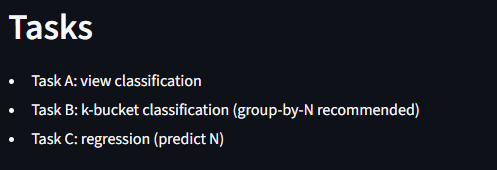
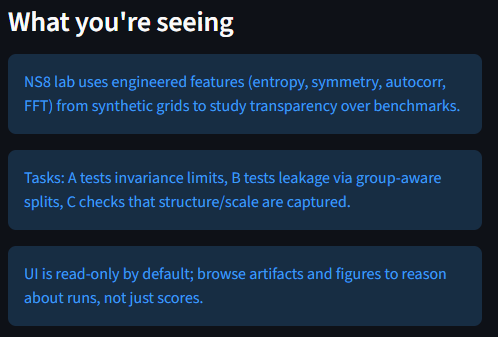
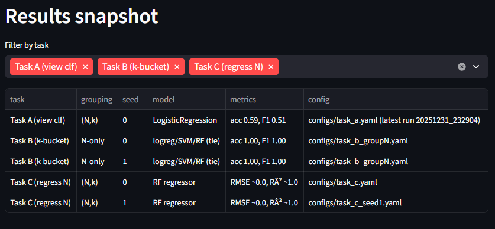

# ns8-supervised-ml-lab

Reproducible supervised-learning experiments on structured NS8 modular grids. Models train on engineered features (entropy, symmetry, autocorr, FFT) to study invariance, leakage, and scale with transparent artifacts.

## Overview
- Tasks: A (view classification, tests invariance limits), B (k-bucket classification, leakage honesty test via group-aware splits), C (regress N, scale sanity check).
- Data: synthetic NS8 grids → engineered features; no raw grids used for training.
- Transparency: runs log metrics, configs, CV results, models, and figures for inspection.

## Design intent
- Representation over model lottery: data is frozen to engineered features and raw grids are excluded so behavior traces to representation choices instead of memorization or capacity.
- Lightweight models by design: small, efficient estimators make leakage and structure issues visible rather than hiding them behind overpowered models.
- Three diagnostic tasks: Task A probes invariance limits (symmetry vs. representation), Task B spotlights leakage via grouping choices, and Task C sanity-checks whether scale and structure are encoded.

## Quick Start
```bash
python -m pip install --upgrade pip
python -m pip install -e .[dev]
python -m pytest
python -m ns8lab.cli dataset --task task_a_view --n-samples 200 --output data/task_a.csv
python -m ns8lab.cli train --task task_a_view --samples 400 --seed 0 --group-mode nk
```
UI: `streamlit run ui/app.py` (read-only by default; set `mode: run` or `NS8_UI_MODE=run` to enable run controls).

## UI usage (Streamlit)
- Layout/density: choose Desktop/Tablet/Mobile and Compact/Comfortable in the sidebar.
- Results Browser: click “Apply filters” to refresh; artifacts column shows missing items (hover). Task B grouping caveat noted.
- Figures tab: pick sources (reports/figures, reports/experiments, runs), optional name filter, max-count slider.
- Dataset Explorer: models use engineered features (no raw grids); grid render is for sanity-checking (N, k, view).
- Run Controls: gated by `ui/config.yaml`; commands shown even in read-only mode.

## UI screenshots
- Tasks panel from the Streamlit app with the three workloads (A: view clf, B: k-bucket clf, C: regress N).


- Overview cards ("What you're seeing") summarizing the engineered-features focus, task intent, and read-only browsing by default.


- Results snapshot table filtered to the three tasks, showing grouping, model choices, and metrics/configs from recent runs.


## Tasks at a glance
- Task A — View classification: probes invariance limits; errors cluster across mirror-related views.
- Task B — k-bucket classification: tests leakage discipline; strict (N,k) grouping can collapse metrics; group-by-N is recommended for baseline.
- Task C — Regress N: checks that scale is encoded; performs near-perfect when features capture structure.

## Results snapshot (multi-seed)
| Task | Seed | Best model | Metrics | Notes |
| --- | --- | --- | --- | --- |
| Task A (view clf) | 0 | LogisticRegression | acc 0.59, F1 0.51 | reports/experiments/20251231_232904/ (feature tweaks) |
| Task A (view clf) | 1 | LogisticRegression | acc 0.44, F1 0.40 | reports/experiments/20251231_232942/ |
| Task B (k-bucket, group N) | 0/1 | logreg/SVM/RF (tie) | acc 1.00, F1 1.00 | group-by-N config: `configs/task_b_groupN.yaml` |
| Task B (k-bucket, group N,k) | 1 | all models | acc 0.00, F1 0.00 | strict (N,k) holdout collapses |
| Task C (regress N) | 0/1 | RF regressor | RMSE ~0.0, R^2 ~1.0 | stable across seeds |

## Common commands
- Dataset: `python -m ns8lab.cli dataset --task task_a_view --n-samples 200 --output data/task_a.csv`
- Train (classify): `python -m ns8lab.cli train --task task_a_view --samples 400 --seed 0 --group-mode nk` (use `--group-mode n` for Task B)
- Train (regress): `python -m ns8lab.cli train --task task_c_regress_n --samples 400 --seed 0`
- Tune: `python -m ns8lab.cli tune --config configs/task_b_groupN.yaml` (Task B recommended), `configs/task_a.yaml`, `configs/task_c.yaml`
- Make targets: `make dataset`, `make train-classify`, `make train-regress`, `make tune`.

## Artifacts
- Per run: `runs/<timestamp>_<task>_<model>/` with `metrics.json`, `config.yaml/json`, `cv_results.csv`, `model.joblib`, `confusion_matrix.png` (classification).
- Mirrored summaries: `reports/experiments/<timestamp>/` and aggregated tables/cards in `reports/results/`.

## Why engineered features (not raw grids)
- Raw grids or deep models would make the tasks trivial via memorization; engineered features constrain what the model can see, making invariance limits, leakage from grouping choices, and scale encoding visible.

## Structure
- `src/ns8lab/` — grids, features, data builder, train/eval pipelines, tuning, CLI.
- `configs/` — YAML configs for tuning tasks.
- `tests/` — unit tests for grids, features, data, training artifacts, tuning.
- `scripts/` — train/tune entry scripts.
- `ui/` — Streamlit app, utils, config, and UI plans (`UI-INFO.md`, `WB-OPT.md`, `UI-FIX.md`, `UI-UPGRADES.md`).
- `reports/results/` — aggregated results/model cards (keep summaries; run-specific artifacts are generated).
- `reports/figures/`, `reports/experiments/` — generated artifacts (gitignored for bulk).
- `data/` — keep small samples; bulk data is gitignored.
- `Makefile`, `pyproject.toml`, `.gitignore`, `LICENSE`, `AGENT-LOG.md`, `AGENT-RULES.md`.

## Cleanup note
- Do not commit bulk artifacts: `runs/`, `reports/experiments/`, `reports/figures/`, large `data/*.csv`.
- Virtualenvs, caches, logs are gitignored; adjust `.gitignore` if you need to track a specific sample.

## Grouped-validation correction (2026-11-16)

The scores above are historical artifacts, not results of the corrected source.
The old Task B N-only recommendation used just N=32 and could not make a
disjoint group holdout with the current split implementation. Its successful
and failed summaries are preserved; their historical split provenance is not
established by the small checked-in summaries. Holding out (N,k) at a single
N with k=1..8 also holds out entire k-bucket classes; failure is informative.

Task B now explicitly defaults to sizes 16,24,32 with N grouping. Recommended
Task B configs declare this changed domain. It is a different finite transfer
question, not a repair of old scores. Both train/tune retain outer and inner
memberships in split.json, use group-aware inner CV, and reject infeasible
groups/class support before any fit. nk groups use k modulo N. Explicit none
means row splitting and does not claim group generalization. Remaining spatial
or feature equivalences need a separate audit for any experiment domain.

Task C writes a matched-input no-fit baseline in baseline.json:
prediction=feat_value_max=N for this synthetic complete-square generator.
Perfect regression alone adds no demonstrated value over that identity.
Raw grids are excluded from model inputs; retained features can expose labels.
See docs/GROUPED_VALIDATION.md for the corrected contract and bounded protocol.

## Opt-in C-order datasets and controlled diagnostics

Native feature extraction remains the default. Dataset generation can explicitly
select the same-formula C-order storage variant:

```bash
python -m ns8lab.cli dataset --task task_a_view --n-samples 2 --n-values 24 --k-values 1 --views BLF TRB --feature-variant c_order_int64_v1 --output data/new-stable.csv
```

Stable outputs carry source/runtime/bin-bound pipeline identity outside `feat_*`
model inputs and refuse existing targets. Native schema/cache behavior stays as
before; train/tune do not adopt this variant. See [dataset contract](docs/C_ORDER_DATASETS.md).

Source includes [Task A exact-input diagnostics](docs/TASK_A_IDENTIFIABILITY.md),
the [layout producer](docs/LAYOUT_STABILITY.md), and a [fixed model control](docs/CANONICAL_MODEL_CONTROL.md).
In the previously reviewed fixed Nk holdout, native and canonical features both
scored **12.5% accuracy** and **0.11538 macro-F1**: no measured improvement.
Eight of48predictions differed despite equal aggregate scores. These results are
scoped to that partition and remain distinct from the historical scores above.
Integration tests are not a rerun of those experiments. Raw cohorts, models and
local receipts are not included; the pinned-input reproduction limits are stated
in the experiment docs. No external-application or learned-benefit claim follows.
